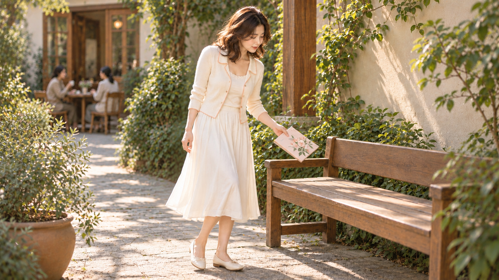

# image2 · 原创风格图像 Skill

最小可运行的“基础Skill＋风格扩展＋本次输入”系统。通用构图、光线、材质、物理接触、动作和验收集中维护；各套风格只写特色，不重复一套大框架。

## 当前状态
- 发布源码：0.3.3，Python 3.10+，只用标准库，无额外运行依赖，无付费API或网络调用。
- 实际最新样片：004-r3，使用0.3.2参数与新动作输入，唯一输入为我方r2，图像工具调用一次。0.3.3是随后固化的通用规则，已做本地文字/结构验证，未追加生图。
- 改进：持握、离座、屈肘和站位更协调；仍有封面朝镜头和点脚的展示余味。未获用户全图通过。



## Skill入口
- [基础Skill](base-image-production/SKILL.md)：通用流程和质量规则。
- [杏序花廊风格Skill](styles/apricot-colonnade/SKILL.md)：奶白桃杏、柔脸光、暖发缘、灰绿温木与细针织。
- [风格扩展模板](references/style-extension-template.md)：固定/变量、覆盖及冲突。
- [九项审查](references/review-methods.md) 与 [动作自然度](references/pose-naturalness.md)：前检设计证据、后检实际像素、明确状态。

动作规则不仅在说明里：base.json已加入目的与单一阶段、抓握/接触受力、身体支撑连动、视线和颈肩放松、空闲肢体与可行移动空间，每次编译会进入基础提示词。具体册子、椅子与半步站位只在本帧输入，不是基础必备。

## 快速运行
```sh
python3 -B -m unittest discover -v
python3 -B compose_prompt.py --base base-image-production/base.json --style styles/apricot-colonnade.json --input inputs/series-004-r3.json --edit inputs/series-004-r3-edit.json --review examples/series-004-r3-before.json --out build/current-preview
python3 -B validate_review.py --review examples/series-004-r3-after.json
```
输出assembled-prompt.txt和assembly-manifest.json。这只组装文字和验证声明，绝不自动生成图片、自动打审美分或代替用户验收。读取完整提示词后，在明确授权范围内另用图像工具执行。

回放历史r3真实文本，请把base/style路径换成versions/0.3.2下的对应文件，其他参数不变。测试会核对它与已记录实际提示词逐字节一致，避免把0.3.3新规则冒充旧图已用。

## 分工与边界
基础规则不得写死人物在哪边、必须有桌子花盆，风格参数不得覆盖自然比例与审查证据。生成前先看重量组、平衡方法、观看联系、留白角色和动作支撑；生成后重新看实际原图，不照抄提示词。生成、编辑、身份参考三种模式不得混淆。竞品只作公开研究，不输入生成工具。

[原创样片/失败回归](examples/README.md) · [版本说明](CHANGELOG.md) · [来源与许可证边界](SOURCES-AND-LICENSE.md)

本仓库为项目级源码，未自动安装到个人Skill系统。没有包含凭据或第三方竞品图片。许可证声明仅用于对应上游来源，不擅自推定所有内容采用同一授权。

## 验证结果
见 [0.3.3 验证说明](TEST-REPORT.md)。运行测试仅检查离线契约与文件完整性，不代表图片审美或用户验收通过。
